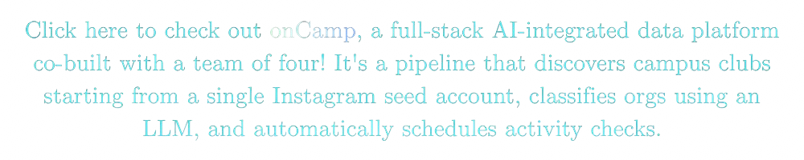
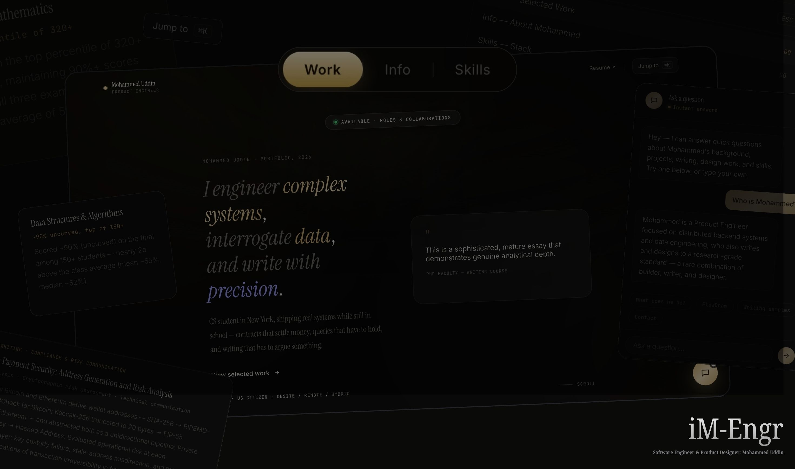

  <h2>
    <a href="https://im-engr474-sep26sys.netlify.app">
      LIVE SITE: Mohammed Uddin's <strong>Personal Website / Portfolio</strong> — iM-Engr
    </a>
  </h2>

  

<h3 align="center">Key Technical Contributions for onCamp (Full-Stack Application; 4-Person Team)</h3>

> **All backend architecture, pipeline optimizations, and project roadmaps below were authored and shipped by Mohammed Uddin under the collaboration account [@mcodes450](https://github.com/mcodes450).**

- **[Issue #7](https://github.com/Sudiptto/onCamp/issues/7):** Proposed DeepSeek club filter reliability and cost optimization.
- **[PR #8](https://github.com/Sudiptto/onCamp/pull/8):** Engineered 22-file backend hardening update including exponential backoff API retries, atomic prompt caching, per-IP rate limiting, and 81 passing unit tests *(Closes #7)*.
- **[Issue #9](https://github.com/Sudiptto/onCamp/issues/9):** Formulated project execution, 5-phase timeline, and go-to-market strategy.
- [View Mohammed Uddin's **Commits**](https://github.com/Sudiptto/onCamp/commits?author=mcodes450)
- [View Mohammed Uddin's **Pull Requests**](https://github.com/Sudiptto/onCamp/pulls?q=is:pr+author:mcodes450)

[View more full-stack application projects →](https://github.com/cryp-moh-graphy/fullstack-product-design)

  

  <h5>
    <a href="https://im-engr474-sep26sys.netlify.app">
      LIVE SITE: Click this link or the portfolio preview image above to view Mohammed Uddin's Personal Website / Portfolio — iM-Engr
    </a>
  </h5>

 

<h3 align="center">Engineering &amp; Design Portfolio</h3>

A collection of selected work spanning backend systems, distributed architectures, AI and data engineering, full-stack development, product design, and technical writing.

#### Engineering

- **[Full-Stack Development](https://github.com/cryp-moh-graphy/fullstack-product-design)**  
  End-to-end application development, system integration, and product implementation.
  
- **[AI & Data Engineering](https://github.com/cryp-moh-graphy/ai-ds-portfolio)**  
  Artificial intelligence, data processing, and applied machine learning.

- **[Distributed Systems & Backend Engineering](https://github.com/cryp-moh-graphy/software-engineering-portfolio)**  
  Distributed architectures, backend systems, and software engineering.

#### Design

- **[Product & Visual Design](https://github.com/cryp-moh-graphy/ui-ux-product-visual-design)**  
  User experience, interface design, and visual systems.

#### Writing & Research

- **[Technical Writing, Research & Data Storytelling](https://github.com/cryp-moh-graphy/data-ux-storytelling)**  
  Technical documentation, research-driven analysis, and data-informed communication.
